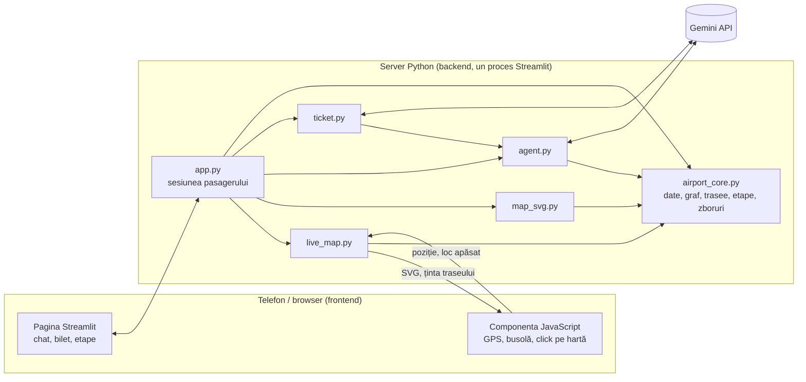

# Airport Copilot – Aeroportul Internațional Craiova

Asistent web pentru telefonul pasagerilor din Aeroportul Internațional Craiova. Arată **harta reală a terminalului cu poziția pasagerului în timp real**, face **trasee pe jos** până la locul pe care apasă, **citește biletul de îmbarcare** dintr-o poză și răspunde într-un **chat în limba română**, doar din date calculate de cod.

Proiect realizat la **Craiova Hackathon V2.0**, provocarea **Autopilot** (AI, automatizare, sisteme inteligente), de echipa **Speranța Albești**.

## Cuprins

- [Problema](#problema)
- [Funcționalități](#funcționalități)
- [Instalare și rulare](#instalare-și-rulare)
- [Arhitectură](#arhitectură)
- [Cum funcționează localizarea live](#cum-funcționează-localizarea-live)
- [Cum funcționează scanarea biletului](#cum-funcționează-scanarea-biletului)
- [Tehnologii și dependențe](#tehnologii-și-dependențe)
- [Securitate și confidențialitate](#securitate-și-confidențialitate)
- [Limitări](#limitări)
- [Stadiul proiectului](#stadiul-proiectului)
- [Testare](#testare)

## Problema

Pentru un pasager care nu zboară des, întrebările din aeroport se repetă:

- **Ce fac acum?** Ordinea pașilor (check-in, control de securitate, poartă) nu e evidentă pentru cine zboară o dată pe an. După controlul de securitate nu se mai pot întoarce la check-in, la toaletă sau la biroul de informații.
- **Unde e…?** Toaleta, ghișeele de check-in, locul unde se poate mânca, poarta.
- **Cât timp mai am?** Mai ales când zborul e întârziat (ceața și zăpada au produs întârzieri și anulări la Craiova): când se deschide îmbarcarea și la ce asistență are dreptul pasagerul.

Un chatbot obișnuit poate inventa o poartă, o oră sau o regulă. În Airport Copilot, AI-ul doar înțelege întrebarea și formulează răspunsul. Traseele, orele și regulile vin din cod determinist, acoperit de teste.

## Funcționalități

- **Hartă reală.** Contururile clădirilor din OpenStreetMap, la scară: holul vechi cu capătul tăiat în diagonală, anexa cu toaleta, clădirea alipită cu securitatea și poarta. Drumul de mers urmează traseul înregistrat pe teren și se curbează spre poartă. Locurile sunt măsurate pe teren.
- **Localizare live.** Telefonul își trimite poziția (GPS + Wi-Fi, din browser), iar pașii numărați de accelerometru, cu direcția din busolă, mișcă punctul lin între citiri. Punctul „Ești aici” merge pe drumul real, cu un cerc care arată precizia, și intră în locul spre care pasagerul are traseu când ajunge la el. Butonul **„Sunt la intrare”** corectează abaterea GPS din ziua respectivă.
- **Harta se întoarce după telefon.** Când pasagerul stă cu fața spre intrare, harta se rotește singură (după busolă), ca dreapta de pe ecran să fie și dreapta lui. Un con albastru arată încotro e îndreptat telefonul.
- **Trasee la un click.** Un loc apăsat pe hartă sau un buton „Du-mă la” dă traseul de la poziția curentă, fără chatbot. Traseul se recalculează când pasagerul se mișcă.
- **Scanarea biletului.** Din poza biletului de îmbarcare, aplicația citește zborul, data și orele tipărite (plecare, îmbarcare, închiderea porții). Pasagerul confirmă ce s-a citit și primește numărătoarea până la îmbarcare, după ora reală a telefonului.
- **Chat AI în română.** Răspunde la întrebări ca „Unde pot mânca?”, „Cât timp am până la îmbarcare?” sau „Mă pot întoarce la check-in?”. Răspunsul și traseul de pe hartă vin din rezultatele codului, nu din text inventat de model.
- **Etapele călătoriei.** Aplicația știe dacă pasagerul a ajuns, a făcut check-in, a trecut de securitate sau e la îmbarcare. După securitate nu îl mai trimite în zona publică. Când GPS-ul îl arată după control, îl întreabă dacă a trecut și schimbă etapa abia după confirmare.
- **Zbor întârziat.** Afișează întârzierea, ora estimată de plecare, când se deschide îmbarcarea și când se poate cere asistență la compania aeriană.

## Instalare și rulare

### Cerințe

- Python 3.11 sau mai nou
- O cheie pentru Gemini API (se obține gratuit din Google AI Studio)
- Pentru folosirea pe telefon: [`cloudflared`](https://developers.cloudflare.com/cloudflare-one/connections/connect-networks/downloads/) (tunel HTTPS)

### Instalare

```bash
git clone https://github.com/113robi/craiova-hackathon.git
cd craiova-hackathon

# opțional, mediu virtual
python -m venv .venv
.venv\Scripts\activate            # Windows; pe macOS/Linux: source .venv/bin/activate

pip install -r requirements.txt
cp .env.example .env              # Windows: copy .env.example .env
```

În `.env` se completează cheia:

```env
API_KEY=cheia_gemini
# opțional; implicit gemini-3.5-flash-lite
GEMINI_MODEL=gemini-3.5-flash-lite
```

### Pornire

```bash
python -m streamlit run app.py
```

Aplicația rulează la `http://localhost:8501`. Serverul ascultă doar pe calculatorul local (setare din `.streamlit/config.toml`); de pe alt dispozitiv se ajunge prin tunelul HTTPS de mai jos. Fără cheie API, harta, traseele și etapele funcționează, iar chatul și scanarea biletului afișează un mesaj de rezervă.

### Acces de pe telefon

Browserele dau acces la locație și la busolă doar pe HTTPS (sau pe `localhost`). Serverul local se expune printr-un tunel Cloudflare:

```bash
cloudflared tunnel --url http://localhost:8501
```

Tunelul afișează un link `https://….trycloudflare.com`, care se deschide în browserul telefonului. În terminal, pasagerul apasă **„Pornește localizarea live”**, permite accesul la locație și apasă **„Sunt la intrare”** când e la intrare.

### Încercare fără să fii în aeroport

În afara terminalului poziția GPS nu are sens, așa că localizarea live rămâne oprită. Restul se poate încerca pe laptop:

1. În bara laterală se alege zborul `W6 5678` (Roma, întârziat 120 de minute în datele simulate).
2. În chat: „Cât timp am până la îmbarcare?”. Răspunsul vine din `flight_status`: ora estimată de plecare, deschiderea îmbarcării și dreptul la asistență.
3. Click pe KFC: traseul trece prin controlul de securitate.
4. „Am făcut check-in”, apoi „Am trecut de securitate”. Întrebarea „Mă pot întoarce la check-in?” primește răspunsul că nu, iar click pe Check-in nu mai dă traseu.
5. `python tools/make_demo_ticket.py` generează `tools/bilet-demo.png` (un bilet marcat „EXEMPLU”). Poza se încarcă la „Scanează biletul de îmbarcare” și, după confirmare, apare numărătoarea până la îmbarcare.

## Arhitectură

Aplicația rulează într-un singur proces Streamlit. Streamlit servește interfața în browser și execută codul Python pe server, deci nu există un API separat între frontend și backend. Codul e împărțit pe straturi: fiecare modul are o funcție publică mică (contractul lui) și se poate testa separat.



| Strat | Fișier | Rol | Contract |
|---|---|---|---|
| Interfață | `app.py` | Pagina Streamlit: hartă, chat, bilet, etape. Ține sesiunea pasagerului și leagă modulele. | punctul de pornire |
| Frontend (JavaScript) | `live_map.py` | Componentă proprie (`st.components.v2`): GPS, filtre Kalman, busolă, click pe hartă, „Sunt la intrare”. | `live_map(svg, state, target) -> {fix, go}` |
| Prezentare | `map_svg.py` | Harta terminalului ca SVG la scară, în două orientări, cu locuri pe care se poate apăsa. | `render_map(position, route, highlight) -> str` |
| AI | `agent.py` | Chat cu Gemini prin function calling. Traseul și locurile evidențiate vin doar din rezultatele tool-urilor. | `chat(session, message) -> {text, route, highlight}` |
| AI | `ticket.py` | Citirea biletului din poză (Gemini, JSON după schemă) și validarea fiecărui câmp. | `read_ticket(image_bytes) -> {ok, ticket}` sau `{ok, error}` |
| Domeniu | `airport_core.py` | Geometria terminalului, graful, Dijkstra, etapele călătoriei, zborurile, tool-urile pentru AI, autotest. | `get_route`, `list_places`, `flight_status`, `next_step`, `apply_live_position` |

`airport_core.py` folosește doar biblioteca standard Python și nu importă niciun alt fișier din proiect. Toate celelalte module depind de el, niciodată invers. Logica (trasee, reguli, ore) se testează fără interfață, fără internet și fără AI.

### Structura repository-ului

```
craiova-hackathon/
├── app.py                  interfața Streamlit (punctul de pornire)
├── live_map.py             componenta JavaScript: localizare live, busolă, click pe hartă
├── map_svg.py              desenul hărții (SVG)
├── agent.py                chatul AI (Gemini, function calling)
├── ticket.py               citirea biletului de îmbarcare (Gemini, JSON validat)
├── airport_core.py         nucleul: date, graf, trasee, etape, zboruri, tool-uri
├── test.py                 verificarea cheii Gemini (o cerere)
├── tools/
│   ├── make_demo_ticket.py    generează un bilet de EXEMPLU pentru testare
│   └── geo-test.html          pagina de măsurare GPS folosită la calibrare
├── .streamlit/
│   └── config.toml            configurarea serverului (doar localhost, limită de upload, fără meniul de dezvoltator)
├── requirements.txt        dependențele, cu versiuni fixate
└── .env.example            modelul fișierului cu cheia API
```

### Drumul unui mesaj din chat

1. `app.py` trimite mesajul la `agent.chat()`, împreună cu sesiunea: etapa, poziția, zborul, ora și biletul.
2. `agent.py` adaugă contextul pasagerului și trimite la Gemini regulile din `SYSTEM_PROMPT` și declarațiile celor 4 tool-uri (`TOOLS` din `airport_core.py`).
3. Gemini alege ce tool-uri să cheme. Codul le execută (`DISPATCH`) și îi trimite înapoi rezultatele, în cel mult 5 runde.
4. Gemini formulează răspunsul în română, doar din acele rezultate.
5. Traseul și locurile evidențiate pe hartă se iau din rezultatele tool-urilor și se filtrează prin lista de locuri cunoscute. Textul modelului nu poate desena nimic pe hartă.

### Decizii de proiectare

- **AI-ul nu decide singur.** Distanțele, orele, accesibilitatea și regulile vin din funcții deterministe. Modelul alege ce funcție să cheme și formulează răspunsul. Dacă o informație lipsește din rezultate, spune că nu o are.
- **Etapa călătoriei se schimbă doar cu confirmarea pasagerului**, din butoane. `tool_advance_state` nu e expus modelului, ca AI-ul să nu poată „trece” pe cineva de securitate.
- **Regula „după securitate nu te mai poți întoarce” e în graf, nu în prompt.** Controlul de securitate e o muchie cu sens unic, deci Dijkstra nu găsește drum înapoi în zona publică.
- **Datele terminalului sunt separate de logică.** Locurile sunt liste în `airport_core.py` (`MAIN_PATH` pentru drumul de mers, `SIDE_PLACES` pentru locurile din lateral), cu coordonate în metri. Un loc nou înseamnă o linie: harta, distanțele, traseele și tool-urile se actualizează singure, iar autotestul verifică dacă locul e în conturul clădirii.
- **Un singur proces Streamlit în loc de frontend și API separate.** Sunt mai puține componente de pornit și de întreținut. Costurile acestei alegeri sunt la [Limitări](#limitări).
- **Harta se redesenează separat de restul paginii** (`st.fragment`). Browserul trimite poziția la server doar când se schimbă zona, ca pagina să nu se reîncarce la fiecare citire GPS.

## Cum funcționează localizarea live

1. Browserul dă latitudinea, longitudinea și precizia, prin `navigator.geolocation.watchPosition`.
2. Coordonatele se transformă în metri: `s` de-a lungul holului (negativ la stânga intrării, pozitiv spre securitate) și `d` de-a curmezișul lui (`geo_to_s` în `airport_core.py`, aceeași formulă și în JavaScript).
3. Citirile cu precizie mai slabă de 40 m se ignoră. Restul trec prin filtre Kalman 1D, ca punctul să nu sară. O citire foarte departe de estimare (peste 3 sigma) contează proporțional mai puțin.
4. **Pași + busolă.** Accelerometrul detectează fiecare pas (vârful accelerației), iar pasul mută punctul cu ~0,65 m în direcția busolei. GPS-ul din interior are erori de 5–15 m care se schimbă de la o secundă la alta. Pașii nu au acest zgomot, așa că punctul nu mai sare înapoi, iar GPS-ul corectează doar abaterea, în ~10 s. Pașii se folosesc după primii 5 detectați și doar cât timp busola dă date; altfel poziția vine doar din GPS. Bara de sub hartă arată câți pași s-au detectat și dacă sunt folosiți („· 23 pasi” sau „(doar GPS)”). `USE_STEPS = False` din `live_map.py` revine la GPS simplu.
5. **Pe lungime**, punctul urmează estimarea și stă pe drumul real, care se curbează. **Pe lățime**, GPS-ul din interior e prea imprecis (la măsurători, intrarea a ieșit mai „sus” decât check-in-ul), așa că punctul se mută lateral doar când poziția e sigură:
   - la cel mult 3 m de locul spre care pasagerul are traseu, punctul intră în loc și apare „Ai ajuns”; iese abia la 6 m, ca să nu sară înainte-înapoi la prag;
   - o deplasare laterală mare (peste 10 m), lângă capătul din stânga și timp de cel puțin 3 s, înseamnă intrarea pe holul spre toaletă.
6. Python primește poziția **doar când se schimbă zona** sau locul, ca pagina să nu se reîncarce continuu. Apoi mută pasagerul pe nodul potrivit, ținând cont de etapă (`locate`, `apply_live_position`), și recalculează traseul.
7. **„Sunt la intrare”** mută estimarea curentă la `s = 0`, fixează referința laterală și aplică aceeași corecție tuturor citirilor următoare. Butonul apare doar la cel mult 20 m de intrare și înainte de securitate, ca să nu poată fi apăsat din greșeală la poartă.
8. **Orientarea hărții.** Harta e desenată cu intrarea jos (aproape nordul sus), cum se vede holul la intrarea din parcare. O hartă fixă apare în oglindă pentru cine stă cu fața spre intrare: pasagerul merge spre dreapta lui (spre vest), iar punctul pleacă spre stânga ecranului. De aceea, cât timp localizarea live e pornită, aplicația citește busola telefonului (`deviceorientationabsolute` pe Android, `webkitCompassHeading` pe iPhone). Când telefonul e îndreptat spre intrare (spre sud), arată harta rotită cu 180°, cu textele drepte (`map_svg.py` desenează ambele orientări în același SVG). Harta se întoarce doar când telefonul e la peste 145° față de „sus”-ul ei (pasagerul cu fața spre intrare) și revine sub 125°, după 0,8 s de confirmare. Mersul de-a lungul holului (~90°, chiar și cu 30° eroare a busolei) dă mereu harta neîntoarsă, deci punctul merge spre dreapta când pasagerul merge spre securitate, indiferent încotro s-a uitat înainte. Butonul **„Întoarce harta”** o rotește manual (laptop, telefon fără busolă). Pe iPhone, busola pornește la apăsarea pe **„Pornește localizarea live”** sau, dacă localizarea a pornit singură, pe **„Rotește după busolă”**.

Măsurători făcute în terminal pe 31.10.2026:

| Telefon | Precizie | Observație |
|---|---|---|
| Samsung S21 | 3–15 m | două sesiuni; distanțele dintre locuri s-au potrivit (intrare → poartă: 67 m și 66,6 m), dar poziția absolută a alunecat cu ~7 m între sesiuni |
| iPhone 16 Pro | 17–50 m | supraestimează distanțele cu ~45% |

Calibrarea folosește media celor două sesiuni S21. Abaterea din ziua folosirii se corectează cu „Sunt la intrare”.

## Cum funcționează scanarea biletului

Codul de bare standard al biletelor (IATA BCBP) conține zborul, data, ruta și locul, dar **nu și ora de plecare**. De aceea biletul se citește din poză:

1. Pasagerul fotografiază biletul (pe hârtie sau pe ecran) sau încarcă o captură de ecran.
2. Poza se rotește după EXIF, se micșorează și se trimite la Gemini, care întoarce JSON după o schemă fixă: zbor, dată, aeroporturi, oră de plecare, îmbarcare, închiderea porții, loc. Numele pasagerului nu se cere.
3. Codul validează fiecare câmp (formatul zborului, orele, data). Câmpurile necitite rămân goale, iar o oră de îmbarcare de după plecare se ignoră.
4. Pasagerul vede ce s-a citit și confirmă. Abia apoi biletul devine zborul lui.
5. Ora programată vine de pe bilet. Întârzierea vine din datele live, simulate în acest prototip. Dacă zborul nu e în datele live, aplicația spune că nu are informații despre întârzieri.

Poza nu se salvează. Pentru testare, `tools/make_demo_ticket.py` generează un bilet marcat „EXEMPLU”, cu cod de bare decorativ:

```bash
python tools/make_demo_ticket.py                    # W6 5678 spre Roma, plecare peste ~2 ore -> tools/bilet-demo.png
python tools/make_demo_ticket.py --plecare 19:30
python tools/make_demo_ticket.py --zbor "W6 1234" --destinatie "LONDRA LUTON" --cod LTN
```

## Tehnologii și dependențe

| Componentă | Tehnologie | Versiune testată | Folosită pentru |
|---|---|---|---|
| Limbaj | Python | 3.15 (minim 3.11) | tot proiectul |
| Interfață și server | [Streamlit](https://streamlit.io) | 1.66.1 | pagina, sesiunea, `st.fragment`, componenta proprie (`st.components.v2`) |
| AI | `google-genai` | 2.34.0 | clientul Gemini: function calling, răspuns JSON după schemă |
| Model | `gemini-3.5-flash-lite` | – | chatul și citirea biletului; se schimbă din `GEMINI_MODEL` |
| Imagini | Pillow | 13.0.0 | rotirea și micșorarea pozei biletului, biletul de exemplu |
| Configurare | `python-dotenv` | 1.2.4 | citirea cheii API din `.env` |
| Trasee | `heapq` (biblioteca standard) | – | Dijkstra pe graful orientat |
| Browser | Geolocation API, DeviceOrientation API | – | poziția (GPS + Wi-Fi) și busola telefonului |
| Date de hartă | OpenStreetMap | – | contururile clădirilor, copiate o singură dată în cod (nu se descarcă la rulare) |
| HTTPS pentru telefon | `cloudflared` (Cloudflare Tunnel) | – | link HTTPS temporar către serverul local |

Versiunile din tabel sunt fixate în `requirements.txt`. Proiectul nu folosește bază de date. Starea fiecărui pasager stă în sesiunea Streamlit, în memoria serverului.

## Securitate și confidențialitate

- **Cheia API** stă doar pe server, în `.env`, care e exclus din git. Browserul nu o primește. Istoricul git a fost verificat și nu conține nicio cheie.
- **Date personale.** Numele de pe bilet nu se cere, iar poza nu se salvează. Nu există conturi și nici bază de date. În browser rămân doar corecția „Sunt la intrare” și orientarea hărții (`sessionStorage`).
- **Datele trimise de browser se verifică pe server.** Poziția GPS trebuie să fie un număr finit și plauzibil, iar un loc apăsat pe hartă trebuie să fie unul dintre locurile cunoscute. Orice altă valoare se ignoră.
- **Validarea intrărilor.** O întrebare în chat are cel mult 300 de caractere. Poza biletului are cel mult 10 MB, e PNG, JPG sau WebP și are cel mult 60 de megapixeli (o imagine mică pe disc se poate decomprima în miliarde de pixeli). Câmpurile citite de pe bilet trec prin formate stricte (zbor, ore, dată, loc), iar textul liber pierde caracterele de formatare.
- **Textul scris de pasager se afișează ca text simplu** (`st.text`), fără Markdown sau HTML: fără linkuri, imagini sau formule.
- **Limită de cereri AI.** Cel mult 5 cereri pe minut pentru fiecare sesiune (mesaje în chat și scanări de bilet), ca un singur utilizator să nu consume cota cheii Gemini. Traseele din hartă nu au limită, pentru că nu folosesc AI.
- **Configurarea serverului** (`.streamlit/config.toml`): serverul ascultă doar pe `localhost`, deci din rețea se ajunge numai prin tunelul HTTPS. O eroare neprevăzută apare în pagină ca mesaj generic, cu detaliile doar în consola serverului. Meniul de dezvoltator (Deploy, Rerun, Clear cache) e ascuns, statisticile de utilizare Streamlit sunt oprite, iar protecțiile XSRF și CORS rămân pornite.
- **Dependențe.** Pe 01.11.2026, cele 52 de pachete instalate (directe și indirecte) nu aveau vulnerabilități cunoscute în baza [OSV](https://osv.dev).

Ce nu acoperă prototipul:

- Aplicația nu are autentificare: oricine are linkul tunelului o poate folosi.
- Limita de cereri AI e per sesiune, iar un refresh pornește o sesiune nouă. Limita cheii Gemini rămâne ultima protecție.
- Streamlit nu permite antete HTTP de securitate (de exemplu `Content-Security-Policy`) fără un reverse proxy în fața lui.

## Limitări

### Limitări ale stack-ului

- **Streamlit rulează din nou scriptul la fiecare interacțiune.** Harta e izolată într-un fragment și poziția se trimite doar la schimbarea zonei, dar butoanele din restul paginii reîncarcă toată pagina.
- **Sesiunea stă în memoria serverului.** Un refresh începe o călătorie nouă. Nu există conturi, istoric salvat sau bază de date, iar un singur proces nu e gândit pentru mulți utilizatori simultan.
- **Chatul și biletul depind de un serviciu extern.** Au nevoie de internet și de Gemini API. Cheia gratuită are o limită de cereri pe minut. Un mesaj în chat folosește de obicei 2–3 cereri (cel mult 5), o scanare de bilet una, iar traseele din hartă și din butoane niciuna. Aplicația acceptă cel mult 5 cereri AI pe minut pentru fiecare sesiune. La eroare sau la depășirea limitei apare un mesaj de rezervă.
- **Locația și busola cer HTTPS.** Pe telefon e nevoie de tunel. Tunelul rapid `trycloudflare` are link temporar și nu e potrivit pentru producție. Pe iPhone, busola cere permisiune printr-o apăsare de buton.
- **Codul JavaScript al hărții e scris direct în `live_map.py`**, fără pas de build și fără teste automate proprii. Formula GPS → metri există și în Python, și în JavaScript.

### Limitări ale localizării și ale datelor

- Precizia GPS în interior ajunge pe lungimea holului, dar nu și pe lățime. De aceea punctul stă pe drumul de mers și intră lateral într-un loc doar la sosire sau pe holul spre toaletă. Traseul pornește din cel mai apropiat punct al drumului.
- Pașii presupun ~0,65 m pe pas și un telefon ținut în față, în direcția de mers. Un pas mai lung sau mai scurt se corectează treptat din GPS. Pe iPhone, pașii și busola pornesc doar după acordul pasagerului (o apăsare de buton).
- Busola poate fi deviată de structurile de metal din clădire (de exemplu lângă scanerele de la securitate). Harta se întoarce doar când direcția e clară, iar „Întoarce harta” o fixează manual.
- Harta acoperă zona măsurată pe teren: holul public, anexa cu toaleta, controlul de securitate și zona de plecări cu Poarta 1. Zona de sosiri nu e modelată.
- Datele live de zbor (întârzieri, poartă) sunt simulate. Nu există încă o legătură cu sistemele aeroportului sau ale companiilor aeriene.
- Calculele de timp folosesc ore din aceeași zi. Pentru un bilet din altă zi, aplicația afișează un avertisment și calculează ca și cum zborul ar fi azi.

## Stadiul proiectului

Toate funcționalitățile descrise mai sus sunt implementate. Pozițiile locurilor și calibrarea GPS vin din măsurători făcute cu telefonul în terminal.

### Ce e real și ce e simulat

- **Măsurat pe teren:** drumul de mers (de la ~8 m la stânga intrării până la poartă, 82 m de la intrare), intrarea, toaleta (la stânga, pe peretele opus, la capătul unui hol lateral de 10–15 m), check-in-ul (14 m), biroul de informații (30 m), securitatea (~50 m), cafeneaua (imediat după securitate) și Poarta 1.
- **Din OpenStreetMap:** contururile clădirilor (pereții de pe hartă).
- **Simulat:** **KFC** (nu există în terminal, e adăugat doar pentru prezentare), starea live a zborurilor (întârzierea zborului `W6 5678`) și regulile de îmbarcare (`RULES`, folosite doar când biletul nu are orele tipărite).
- **Necunoscut:** programul cafenelei. Agentul nu spune că un loc e deschis dacă nu știe.

### Progresul pe zile

| Ziua | Ce s-a realizat |
|---|---|
| 1 (30.10.2026) | Alegerea provocării și a problemei, repository-ul GitHub, accesul la Gemini API. |
| 2 (31.10.2026) | Nucleul (graf, Dijkstra, etape, zboruri, tool-uri), agentul Gemini și interfața Streamlit. Măsurători pe teren în terminal (Samsung S21 în două sesiuni, iPhone 16 Pro). Harta la scară după OpenStreetMap, localizarea live, traseele la click, scanarea biletului și rotirea hărții după busolă. |
| 3 (01.11.2026) | Interfața adaptată pentru telefon, măsurile de securitate, localizarea cu pași + busolă (testată în simulare: eroarea medie în mers a scăzut de la 3,9 m la 1,1 m, fără salturi înapoi), documentația și prezentarea finală. |

## Testare

```bash
python airport_core.py                  # autotestul nucleului, fără internet -> OK
python ticket.py                        # validarea datelor citite de pe bilet, fără internet -> OK
python map_svg.py                       # scrie o previzualizare HTML a hărții și afișează calea
python test.py                          # verifică cheia Gemini (1 cerere)
python ticket.py tools/bilet-demo.png   # citirea reală a biletului de exemplu (1 cerere Gemini)
python agent.py                         # 4 întrebări reale către agent (consumă din cota Gemini)
```

Autotestul nucleului verifică, printre altele:

- fiecare loc e în interiorul contururilor reale ale clădirilor;
- traseul intrare → poartă trece prin controlul de securitate, într-un singur sens, și are între 77 și 90 m;
- după securitate nu există traseu spre check-in, toaletă sau ieșire, iar mâncarea apare doar după control;
- etapele merg doar înainte, iar cu bagaj de cală nu se poate sări peste check-in;
- orele de zbor, cu și fără bilet scanat, și dreptul la asistență la întârzieri de cel puțin 2 ore;
- calibrarea GPS se potrivește cu măsurătorile de pe teren (la ±0,5 m);
- după securitate, zgomotul GPS nu mută pasagerul înapoi în zona publică.

`tools/geo-test.html` e pagina de măsurare folosită la calibrare: arată metrii de la intrare, face media citirilor la salvare și poate înregistra tot traseul.
